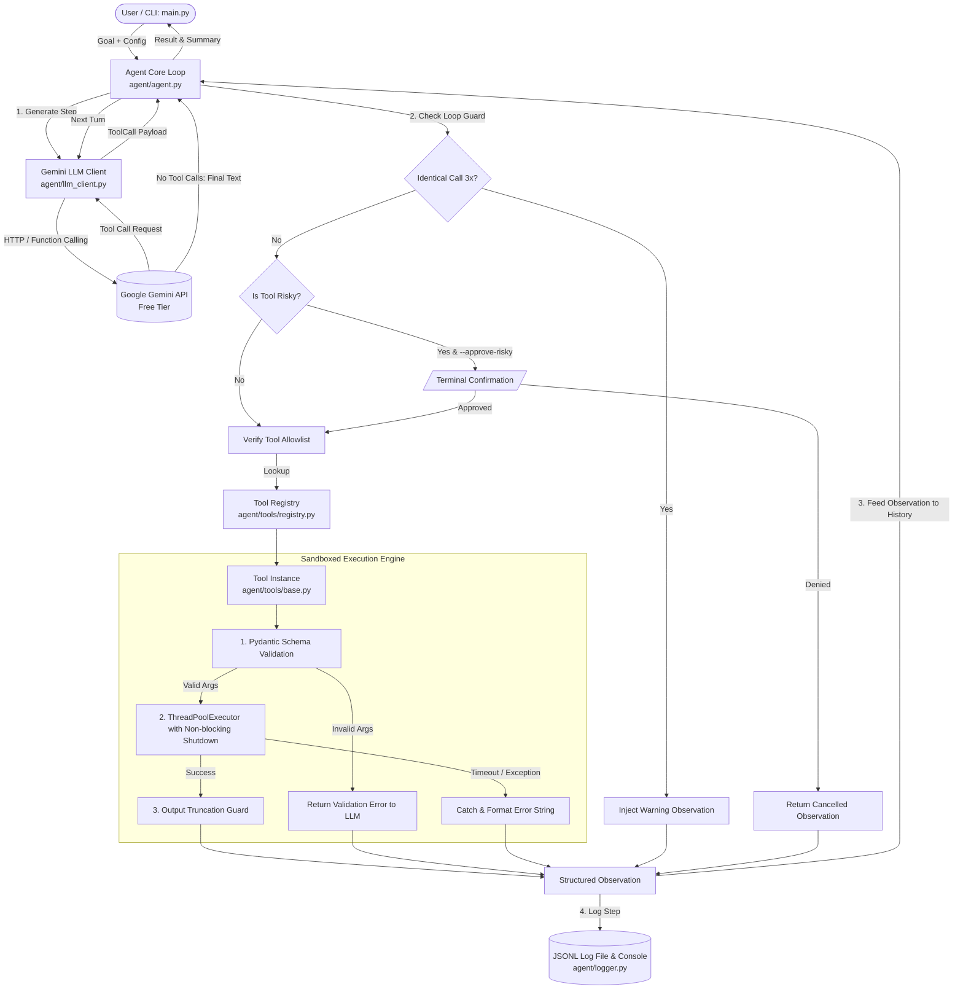

# Explainer: Task-Automating AI Agent

A comprehensive architectural and conceptual walkthrough for the **Task-Automating AI Agent**. This document is designed to equip you with the foundational understanding required to explain every mechanical part of this system in technical interviews and code reviews.

---

## Table of Contents
1. [Core Concepts: Agent vs. Chatbot & Tool Calling](#1-core-concepts-agent-vs-chatbot--tool-calling)
2. [High-Level Architecture & Mermaid Diagram](#2-high-level-architecture--mermaid-diagram)
3. [Component Breakdown (Role of Each File)](#3-component-breakdown-role-of-each-file)
4. [Line-by-Line Walkthrough: Agent Loop & Tool System](#4-line-by-line-walkthrough-agent-loop--tool-system)
5. [Traced Example Run (Actual Message Exchanges)](#5-traced-example-run-actual-message-exchanges)
6. [Failure Modes & Error Controls](#6-failure-modes--error-controls)
7. [Design Trade-offs, Limitations & Future Enhancements](#7-design-trade-offs-limitations--future-enhancements)
8. [Setup, API Key Acquisition & Execution Guide](#8-setup-api-key-acquisition--execution-guide)

---

## 1. Core Concepts: Agent vs. Chatbot & Tool Calling

### What is a Chatbot?
A traditional **chatbot** is a single-turn or multi-turn conversational interface. It functions as a closed predictive text engine:
- It receives an input prompt $P$.
- It predicts the most likely next tokens based strictly on static model weights acquired during pretraining and fine-tuning.
- **Limitation**: It cannot interact with external systems, fetch live web data, inspect local files, run computations with mathematical certainty, or take autonomous actions.

### What is an AI Agent?
An **AI agent** is an autonomous entity that combines reasoning with action (the **ReAct pattern** — Reasoning + Acting). Rather than simply answering a prompt, an agent is given a **high-level objective** and operates inside an execution loop:
1. **Perceive**: Inspects the current state, goal, and prior observations.
2. **Reason**: Formulates a plan or chooses which tool to invoke.
3. **Act**: Issues a structured request to run external code (search the web, query a file, evaluate math).
4. **Observe**: Ingests the output of that action back into its working memory.
5. **Decide**: Evaluates whether the objective has been reached or if subsequent steps are required.

```
+-------------------------------------------------------------+
|                      Agent Control Loop                     |
|                                                             |
|   +--------+      +--------+      +-------+     +--------+  |
|   | Perceive| ---> | Reason | ---> | Act   | --->| Observe|  |
|   +--------+      +--------+      +-------+     +--------+  |
|       ^                                              |      |
|       +----------------- Loop / Continue ------------+      |
+-------------------------------------------------------------+
```

### What is Tool Calling (Function Calling)?
Language models cannot execute Python code or access network sockets directly inside their inference engines. Instead, modern foundation models (such as Google Gemini) are trained to perform **native function calling**:
1. The host program provides the model with a list of available tools, each accompanied by an **OpenAPI-compliant JSON Schema** describing its name, purpose, and argument structure.
2. When the user prompt warrants an action, rather than generating freeform conversational prose, the model outputs a structured payload:
   ```json
   {
     "name": "web_search",
     "arguments": {"query": "Python 3.13 release highlights", "max_results": 3}
   }
   ```
3. The host application halts LLM generation, runs the designated local function in Python, and returns the result to the model as a function response (`Part.from_function_response(...)`).
4. In Gemini's protocol, function responses are submitted back under `role="user"`. When multiple tools are invoked in a single turn, their responses are merged into a single `user` Content message.
5. The model consumes this factual observation to formulate its next reasoning step or construct its final response.

---

## 2. High-Level Architecture & Mermaid Diagram

The codebase is organized cleanly without third-party agent frameworks (like LangChain, AutoGen, or CrewAI). Every mechanism is transparent and inspectable.



---

## 3. Component Breakdown (Role of Each File)

| File | Purpose & Architectural Role |
| :--- | :--- |
| `agent/config.py` | Central configuration using **Pydantic Settings**. Loads `.env` variables (`GEMINI_API_KEY`, `GEMINI_MODEL`, `MAX_ITERATIONS`, `TOOL_TIMEOUT_SECONDS`, `MAX_OUTPUT_LENGTH`, `WORKSPACE_DIR`). Validates API keys and establishes the sandbox path. |
| `agent/logger.py` | Observability layer. Writes complete structured event streams to `logs/run_<timestamp>.jsonl` while simultaneously rendering clean terminal output during `--verbose` runs. |
| `agent/tools/base.py` | Abstract Base Class `Tool`. Implements automatic OpenAPI JSON schema generation via Pydantic v2 `model_json_schema()`, per-tool timeout enforcement using `ThreadPoolExecutor` (with prompt shutdown on timeout), output truncation, and input validation. |
| `agent/tools/registry.py` | Tool catalog. Manages available tools, enforces security allowlists (`allowed_tools`), and formats declarations for LLM consumption. |
| `agent/tools/calculator.py` | Safe arithmetic evaluation. Uses Python's `ast` (Abstract Syntax Tree) to parse mathematical expressions without `eval()`. Includes DoS protections: expression length limit, operand magnitude cap, and exponent capping. |
| `agent/tools/web_search.py` | Real-time web querying. Leverages DuckDuckGo (`ddgs`) to return live web search titles, URLs, and snippets without requiring paid search API subscriptions. |
| `agent/tools/file_ops.py` | Sandboxed file system operations (`file_read`, `file_write`, `file_list`). Enforces strict boundary checks against `./workspace` using `Path.is_relative_to()`. Flags `file_write` with `is_risky=True`. Blocks directory traversal (`../`), sibling directories (`workspace_evil`), and absolute path escapes. |
| `agent/tools/datetime_tool.py` | Temporal grounding tool. Returns local system time, UTC time, ISO 8601 strings, and days of the week so the agent can accurately ground relative queries (e.g., "current year", "today's date"). |
| `agent/tools/summarizer.py` | Rule-based text condenser. A heuristic sentence extraction tool that ranks and extracts key takeaway sentences based on sentence position and keyword frequency (not an external ML model). |
| `agent/llm_client.py` | Provider-agnostic abstraction (`BaseLLMClient`, `ChatMessage`, `ToolCall`, `LLMResponse`). Contains `GeminiLLMClient` wrapping Google's official `google-genai` SDK with targeted retries (429, 500, 503) and immediate failure on 400 client errors, plus `MockLLMClient` for offline testing. |
| `agent/agent.py` | Core agent engine. Orchestrates the ReAct loop: history maintenance, LLM invocations, loop guards, human approval verification, tool execution, observation ingestion, and termination checks. Preserves model `raw_content` to retain thought signatures on Gemini 3.x models. |
| `main.py` | Command-line interface (CLI). Exposes options `--verbose`, `--approve-risky`, `--model`, `--max-iterations`, and `--tools`. Handles missing credentials gracefully. |
| `scripts/list_models.py` | Diagnostic script. Uses the configured Gemini API key to list all models available to the account, dynamically highlighting available Flash models. Never prints any part of the API key. |
| `tests/` | Comprehensive test suite containing 36 unit and integration tests using `MockLLMClient` with zero external network or API dependencies, plus 1 optional live test. |

---

## 4. Line-by-Line Walkthrough: Agent Loop & Tool System

### The Agent Loop (`agent/agent.py`)

Here is how the main loop in `Agent.run()` functions step-by-step:

```python
# 1. Initialize conversation history with the user's objective
history: List[ChatMessage] = [ChatMessage(role="user", content=goal)]
iteration = 0

while iteration < self.settings.max_iterations:
    iteration += 1

    # 2. Invoke the LLM with current conversation history & tool schemas
    response = self.llm_client.generate(
        messages=history,
        tools=available_tools,
        system_instruction=self.system_instruction,
    )

    # 3. Check Termination Condition:
    # If the LLM generates a text message without requesting any tools,
    # the task is complete.
    if not response.tool_calls:
        final_answer = response.text
        success = True
        history.append(
            ChatMessage(
                role="model",
                content=final_answer,
                raw_content=response.raw_content,
            )
        )
        break

    # 4. Record the model's action turn in conversation history, preserving raw_content
    history.append(
        ChatMessage(
            role="model",
            content=response.text,
            tool_calls=response.tool_calls,
            raw_content=response.raw_content,
        )
    )

    # 5. Process each tool call requested by the model
    for tool_call in response.tool_calls:
        tool_name = tool_call.name
        tool_args = tool_call.arguments

        # 6. Loop Guard Check:
        # Detect if the model is repeating the exact same call 3 times in a row
        signature = self._serialize_tool_call(tool_name, tool_args)
        if consecutive_identical_count >= 3:
            history.append(ChatMessage(role="tool", tool_name=tool_name, tool_result=loop_warning))
            continue

        # 7. Risky Tool Approval Check:
        if tool.is_risky and self.settings.approve_risky:
            authorized = self._request_user_approval(tool_name, tool_args)
            if not authorized:
                history.append(ChatMessage(role="tool", tool_name=tool_name, tool_result="Action Cancelled by User"))
                continue

        # 8. Safe Tool Execution:
        # Validates arguments via Pydantic, enforces timeouts, catches crashes
        observation = tool.run_with_timeout(
            args=tool_args,
            timeout_seconds=self.settings.tool_timeout_seconds,
            max_output_length=self.settings.max_output_length,
        )

        # 9. Feed Observation back to the LLM (internal role="tool"):
        history.append(
            ChatMessage(
                role="tool",
                tool_name=tool_name,
                tool_result=observation,
            )
        )
```

### SDK Role Conversion (`agent/llm_client.py`)

Gemini's REST API does not support `role="tool"`. In `GeminiLLMClient._convert_messages()`:
1. Internal `role="user"` messages map to `types.Content(role="user", ...)`.
2. Internal `role="model"` messages forward `raw_content` if present (retaining thought signatures), or map to `types.Content(role="model", ...)`.
3. Consecutive internal `role="tool"` messages are merged into a **single** `types.Content(role="user", parts=[Part.from_function_response(...), ...])`, in the exact order requested by the model.

---

## 5. Traced Example Run (Actual Message Exchanges)

Here is a trace of the messages exchanged when executing a multi-tool goal:
> *"What is 17*23, and what is today's date?"*

### Turn 1: Initial Prompt & Tool Choices
- **User Message (`role: "user"`)**:
  ```text
  What is 17*23, and what is today's date?
  ```
- **Gemini Model Response (`role: "model"`)**:
  - The model calls both tools in a single turn:
    - Tool Call 1: `calculator(expression="17 * 23")`
    - Tool Call 2: `current_datetime()`

### Turn 2: Merged Tool Observation Turn
- Internally, two `ChatMessage(role="tool")` entries are recorded:
  - `ChatMessage(role="tool", tool_name="calculator", tool_result="Result: 391")`
  - `ChatMessage(role="tool", tool_name="current_datetime", tool_result="Current Temporal Context:\n- Local Time: 2026-10-12 ...")`
- When sent to the Gemini SDK, these are converted into a **single user Content** message:
  ```python
  types.Content(
      role="user",
      parts=[
          types.Part.from_function_response(name="calculator", response={"result": "Result: 391"}),
          types.Part.from_function_response(name="current_datetime", response={"result": "Current Temporal Context: ..."}),
      ],
  )
  ```

### Turn 3: Final Response
- **Gemini Model Response (`role: "model"`)**:
  - *No Tool Calls Requested*.
  - *Final Answer Text*:
    ```text
    17 * 23 equals 391, and today's date is October 12, 2026.
    ```
- **Agent Termination**: The agent detects zero tool calls, logs the final answer, and concludes.

---

## 6. Failure Modes & Error Controls

| Failure Mode | Risk / Impact | Engineering Defense Mechanism |
| :--- | :--- | :--- |
| **Runaway Loop (Infinite Turns)** | The agent repeatedly calls tools without reaching a stopping condition. | `MAX_ITERATIONS` limit (default 10). When reached, the loop breaks cleanly and returns a structured failure summary. |
| **Hanging External Tool** | A slow network request or blocked process locks the thread indefinitely. | Per-tool timeout via `ThreadPoolExecutor(timeout=settings.tool_timeout_seconds)`. On timeout, calls `executor.shutdown(wait=False, cancel_futures=True)` so it returns promptly without waiting for the hung thread. |
| **Calculator DoS (`9**9**9`)** | Huge exponents or giant integers lock up CPU/memory. | AST pre-evaluation limits: `MAX_EXPRESSION_LENGTH = 200`, `MAX_OPERAND = 1e12`, `MAX_EXPONENT = 100`, and `MAX_RESULT = 1e100`. Returns clean error message without hanging. |
| **API Rate Limits (HTTP 429)** | Free tier quota spikes or rate exhaustion (`RESOURCE_EXHAUSTED`). | Targeted exponential backoff retry loop in `GeminiLLMClient`. Honors server suggested delay (`Retry-After`) or calculates jittered backoff, capped at 30s. |
| **Client Errors (HTTP 400, 401, 403, 404)** | Invalid request parameters or bad credentials. | Fails immediately with clear diagnostic error message; never wastes retries on non-retryable 4xx errors. |
| **Malformed Tool Arguments** | Model invents parameters or passes incorrect data types. | `Pydantic` validation catches `ValidationError`. The exact validation error is serialized into a tool observation, allowing the model to self-correct. |
| **Directory Traversal Attack** | Hallucination or prompt injection attempts to access system files (`../../` or `workspace_evil`). | Enforces `Path.resolve().is_relative_to(workspace_resolved)`. Traversal attempts raise a `PermissionError` and execution is denied. |
| **Destructive File Modification** | Unintended file overwrites or sensitive mutations. | Flagging risky tools (`is_risky=True`) and requiring explicit user authorization via terminal prompt when `--approve-risky` is specified. |

---

## 7. Design Trade-offs, Limitations & Future Enhancements

### Design Trade-offs
1. **Raw Python vs. Agent Frameworks**:
   - *Choice*: Built with zero agent frameworks (no LangChain, CrewAI, AutoGen).
   - *Trade-off*: We write our own history management and retry logic, but gain complete transparency, clean interview explainability, and full debugging control.
2. **Rule-Based Summarizer**:
   - *Choice*: Simple heuristic sentence ranker based on sentence position and keyword frequency.
   - *Trade-off*: Zero external NLP dependencies and zero latency, but less nuanced than a dedicated generative model.

### Current Limitations
- **Stateless Across Runs**: The agent does not persist memory across multiple CLI runs. Every run starts with a fresh conversation history.
- **Short-Term Context Window**: While outputs are truncated at `MAX_OUTPUT_LENGTH`, a very long multi-step run accumulates significant token history.

### Future Architectural Improvements
1. **Dynamic Context Compression**:
   When conversation history exceeds a token threshold, summarize older turns while keeping the initial goal and the latest 2 turns intact.
2. **Async Parallel Tool Execution**:
   When the model emits multiple tool calls in a single turn, execute them concurrently using `asyncio` to reduce end-to-end latency.
3. **Automated Evals**:
   Implement an automated benchmark harness to evaluate agent trajectory efficiency across diverse tasks.

---

## 8. Setup, API Key Acquisition & Execution Guide

### 1. How to Obtain a Free Gemini API Key
1. Navigate to [Google AI Studio](https://aistudio.google.com/app/apikey).
2. Sign in with your Google account.
3. Click **"Create API Key"** and choose or create a project.
4. Copy the generated key.

### 2. Configure Environment
In the project root, copy `.env.example` to `.env`:
```powershell
copy .env.example .env
```
Open `.env` and set:
```ini
GEMINI_API_KEY=your_key_here
GEMINI_MODEL=gemini-2.5-flash
```

### 3. Verify Available Models
Run the helper script:
```powershell
.\.venv\Scripts\python scripts/list_models.py
```

### 4. Running the Agent
Run standard goal:
```powershell
.\.venv\Scripts\python main.py "What is 17*23, and what is today's date?" --verbose
```

Run with human-in-the-loop approval on risky tools:
```powershell
.\.venv\Scripts\python main.py "Write a report to summary.txt" --approve-risky
```

Restrict tools to an allowlist:
```powershell
.\.venv\Scripts\python main.py "Calculate 50 * 20" --tools "calculator"
```

### 5. Running Automated Tests (Offline)
The offline test suite runs with mocked LLM clients:
```powershell
.\.venv\Scripts\pytest -q
```
